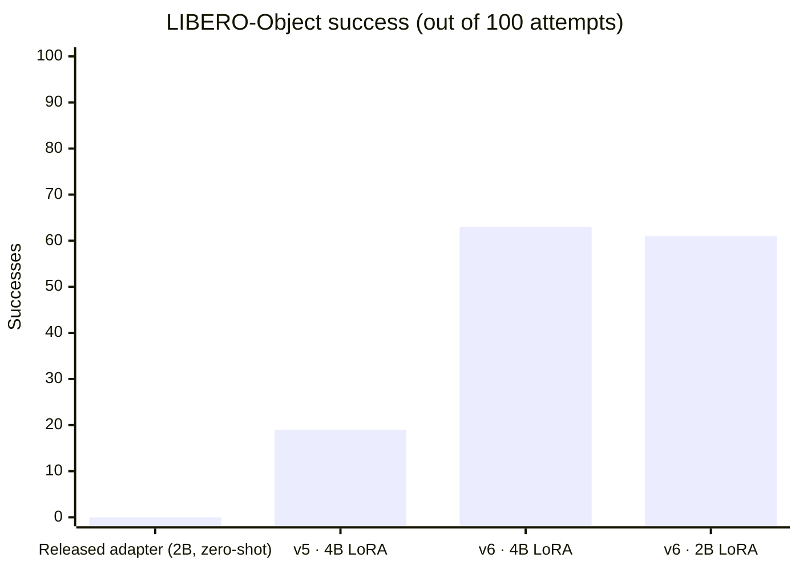

# LoRA fine-tuning Qwen3.5 VLMs as LIBERO robot policies

Fine-tuning and closed-loop evaluation of **Qwen3.5-4B and Qwen3.5-2B** as vision-language-action
policies on the ten **LIBERO-Object** pick-and-place tasks. A rank-64 language LoRA (frozen vision tower
and projector) learns to emit [Show-Harness](https://github.com/showlab/Show-Harness) semantic action tokens
(`MV_*` 1 cm moves, `RT_*` 5° turns, `GRASP`, `RELEASE`, `DONE`) from two camera views.

Through failure analysis, a targeted data and prompt change, and checkpoint selection on held-out data,
success under a frozen 100-attempt protocol went from **19/100 to 63/100** (4B). The same recipe on the
2B backbone reaches **61/100**, with no detectable difference from 4B.

> **Context.** This work was done within *EdgeWise*, a research project on edge-first robot intelligence
> with selective cloud escalation. The question here was whether a small VLM that can run at the edge can be
> fine-tuned into a working manipulation policy. This repository extracts the fine-tuning, evaluation and
> analysis part of that project. The rest of the project (robot bring-up, cloud escalation) is not included.

## Progress

All numbers are LIBERO task-predicate successes on the ten LIBERO-Object tasks, standard initial states 0–9,
one rollout per start.



| Stage | Model | What changed | Success | Details |
|---|---|---|---:|---|
| 0. Released adapter, no training | Show-Harness `qwen3_5_2b_sim` | Baseline: adapter trained on ManiSkill and RoboLab, used as released | 0/100 Object (0/298 over three LIBERO suites)¹ | [baseline-results](docs/baseline-results.md) |
| 1. Single-task check | Qwen3.5-4B LoRA | Can the pipeline learn one task? Epoch 1: 0/10, epoch 40: **6/10** (expert replay: 9/10) | 6/10 (one task) | [single-task-results](docs/single-task-results.md) |
| 2. **v5**: suite-level fine-tune | Qwen3.5-4B LoRA | One shared adapter, all ten tasks, 1 cm / 5° actions, 3,464 updates | **19/100** | [results](docs/results.md) |
| 3. **v6**: state line + changepoint oversampling | Qwen3.5-4B LoRA | Robot-state line in the prompt, 3-move history, action changes ×4 in training; adapter selected on held-out changepoints | **63/100** (McNemar p ≈ 1e-12 vs v5) | [results-v6](docs/results-v6.md) |
| 4. **v6 on 2B** | Qwen3.5-2B LoRA | Same data and technique on the smaller Show-Harness default backbone | **61/100** (p ≈ 0.85 vs 4B) | [results-v6-2b](docs/results-v6-2b.md) |

¹ Different protocol (released prompt v3, 2 cm actions, 200-action limit). It shows that the released
adapter does not transfer to LIBERO, not a like-for-like baseline.

### Trained adapters

The evaluated adapters are on Hugging Face. Each one's SHA-256 matches the hash recorded in its frozen evaluation.

| Adapter | Base | Success | Hugging Face |
|---|---|---:|---|
| v6, adapter-3500 | Qwen3.5-4B | 63/100 | [kugelblytz/qwen3.5-4b-libero-object-v6-lora](https://huggingface.co/kugelblytz/qwen3.5-4b-libero-object-v6-lora) |
| v6, adapter-3500 | Qwen3.5-2B | 61/100 | [kugelblytz/qwen3.5-2b-libero-object-v6-lora](https://huggingface.co/kugelblytz/qwen3.5-2b-libero-object-v6-lora) |
| v5, checkpoint-3464 | Qwen3.5-4B | 19/100 | [kugelblytz/qwen3.5-4b-libero-object-v5-lora](https://huggingface.co/kugelblytz/qwen3.5-4b-libero-object-v5-lora) |

Each repository contains the adapter, the frozen prompt, the training config, the dataset manifest and checksums.

### What moved the number from 19 to 63

1. **Diagnose the failures.** In v5, 45 of 81 failures never issued `GRASP`, and 24 attempts repeated
   `RT_YAW_CW` until the 400-decision limit. Pose logs showed that the arm breaks away after about 125° of yaw
   ([experiment log](docs/experiment-log.md), [rotation check](docs/rotation-prediction-check.md)).
2. **Find the cause.** The prompt gave the model only images and its last five tokens, with no signal of
   how far it had already turned or whether the gripper was closed. Action changes were also rare in the
   1 cm data (`GRASP` was 0.71% of labels).
3. **Make one targeted change** ([state-and-changepoints](docs/state-and-changepoints.md)):
   - a measured `Robot state:` line in the prompt (gripper open/closed, net turn since start), computed with
     the same function in training export and rollout;
   - a 3-move history instead of 5;
   - every action change and every `GRASP`/`RELEASE`/`DONE` row repeated 4× in the training split only.
4. **Select checkpoints on held-out data, not on validation loss.** A teacher-forced changepoint check on
   held-out episodes ranked the snapshots, and its ranking matched the rollouts. The end-of-training adapter
   had overfitted: changepoint accuracy fell back from 0.72 to 0.49, and validation loss rose from 0.084 to
   0.139.

Result: yaw loops 24 → 0, attempts that issue `GRASP` 55 → 100, attempts that issue `RELEASE` 3 → 60, and
total evaluation time 6.0 h → 2.4 h.

### Where it still fails

All 37 remaining 4B failures happen with an empty gripper: the fingers close on nothing, and the model never
re-grasps, because expert demonstrations never miss. 2B grips the flat boxes that 4B misses but then fails to
place them. Next steps are written up but not run: grasp outcome in the state line, synthetic recovery data,
and an executor-level grasp check ([results-v6 §6](docs/results-v6.md#6-recommended-next-steps)).

## Training setup

| | |
|---|---|
| Base models | Qwen3.5-4B, Qwen3.5-2B |
| Adapter | LoRA r=64, α=128, dropout 0.05 on all language-model linear layers; vision tower and projector frozen; BF16 |
| Trainer | LLaMA-Factory (pinned revision), Show-Harness `qwen3_5_nothink` template, cutoff 2048 |
| Data | 433 converted LIBERO-Object demonstrations, split by episode into 389 train / 44 validation; 55,411 training examples |
| Optimisation | lr 1e-4, cosine schedule, 10% warm-up, effective batch 32, seed 42, equal task mixing |
| Budget | 6,928 updates (v6); checkpoint every 250 updates, adapter snapshot every 500 |
| Hardware | One H100 MIG slice (about 20 GB); with optimised Gated DeltaNet kernels about 4.2 s per update (4B) and 3.4 s (2B) |
| Evaluation | Frozen protocol: 10 standard starts × 10 tasks, native 400-decision budget, two-camera videos for every attempt |

Reproducibility features in [`scripts/train.py`](scripts/train.py) and [`scripts/evaluate.py`](scripts/evaluate.py):
- `--resume latest` restores adapter, optimizer, scheduler and RNG state from the newest complete checkpoint;
  a crash supervisor ([`train_resilient.sh`](scripts/train_resilient.sh)) relaunches it.
- Dataset files, training config, prompt, chat template and robot configuration are checked against SHA-256
  hashes before training; evaluation re-checks prompt, template and robot config, and records the adapter hash.
- Evaluation settings are frozen in a JSON file next to each run, and runs are compared with
  [`compare_evaluations.py`](scripts/compare_evaluations.py).
- Results are tested with paired exact McNemar tests on (task, start) pairs.

## Repository layout

```
scripts/            pipeline: prepare → export_variant → train → check_changepoints → evaluate → analyze
  contract.py       action contract (1 cm / 5°), state line and turn computation shared by export and rollout
  pipeline.sh       entry point for all stages
  sim/              model serving (vLLM), LIBERO rendering, rollout videos
configs/            Show-Harness-aligned LoRA training configs (2B, 4B)
commands/           exact command sequences used for each run (v5, v6, v6-2B)
docs/               plan, results per stage, failure analyses, setup
evidence/           compact JSON summaries behind every number in the results docs
serving/            pinned serving dependencies
```

Videos, decision logs, checkpoints and datasets are large and are not included.

## Running it

The pipeline needs a Linux machine with an NVIDIA GPU (about 20 GB), checkouts of Show-Harness and LIBERO
at the pinned revisions, and separate Python environments for simulation, training and serving. All of these
live under `.workspace/` in the repository root, which can be a symlink.

1. Setup: [docs/setup.md](docs/setup.md) (LIBERO, rendering) and [docs/serving.md](docs/serving.md) (vLLM).
2. Data preparation and v5 training: [docs/RUNNING.md](docs/RUNNING.md) and [commands/command.txt](commands/command.txt).
3. v6 variant, 4B: [commands/v6-training-command.txt](commands/v6-training-command.txt) (export, train,
   changepoint check, frozen evaluation, comparison).
4. v6 variant, 2B: [commands/v6-2b-training-command.txt](commands/v6-2b-training-command.txt).

## Limitations

- Evaluation tasks are the training tasks, which is standard LIBERO practice. This measures whether the fixes
  work, not generalisation to unseen tasks.
- One rollout per start: per-task differences of 1–2 successes are noise. The paired overall differences
  are what the claims rest on.
- adapter-3500 is a mid-schedule snapshot (learning rate about 58% of peak), not a settled model.
- v6 changed three things at once (state line, history length, oversampling) and trained for twice as many
  updates as v5. It shows that the package works, not which part did it; each component has an ablation
  switch in [`export_variant.py`](scripts/export_variant.py).
- The 1 cm semantic executor needs 976–3,304 simulator steps per success, against OpenVLA's 280-step
  LIBERO-Object horizon, so success rates are not directly comparable with OpenVLA.

## References

- [Show-Harness: Just a VLM Agent Can Play Robots](https://arxiv.org/abs/2609.10522) (Chen et al., 2026): semantic action tokens,
  executor and the LoRA recipe this work starts from.
- [LIBERO](https://github.com/Lifelong-Robot-Learning/LIBERO): tasks, assets and initial states.
- [OpenVLA](https://openvla.github.io/): LIBERO-Object fine-tuning protocol used as the comparison reference.
- Full source list: [docs/references.md](docs/references.md).

## License

[Apache-2.0](LICENSE), matching Show-Harness and LLaMA-Factory, which this pipeline builds on.
